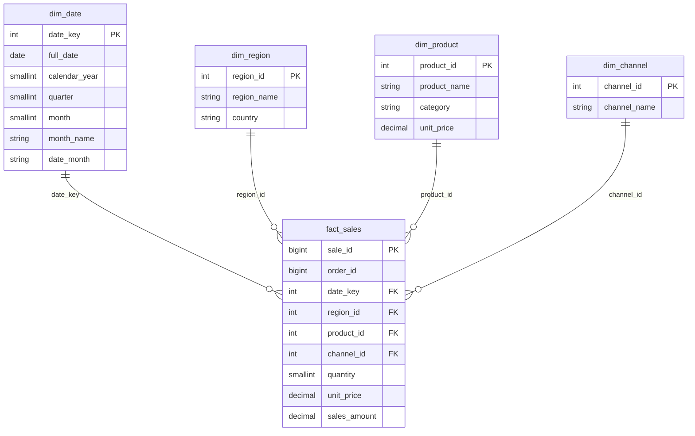

# Schéma du modèle analytique

Schéma en étoile. `fact_sales` est au centre. Les dimensions portent les
libellés utilisés par les KPI. Les contraintes de clés ne sont pas imposées
par Parquet ; elles sont contrôlées par les tests.

## Lecture décisionnelle

| Question | Requête | Axes |
|---|---|---|
| CA, commandes et panier moyen du pilotage mensuel | `monthly_kpis.sql` | mois, région, catégorie |
| Sous-totaux et total général | `cube.sql` | les 8 niveaux du `CUBE` |
| Le même pilotage, avec le canal de vente | `channel_kpis.sql` | mois, région, catégorie, canal |

Le grain d'une commande est plus haut que le grain du fait : une commande a
une date, une région et un canal, et une ou plusieurs catégories. C'est pour
cela que `COUNT(DISTINCT order_id)` et le panier moyen ne s'additionnent pas
le long de la catégorie.
